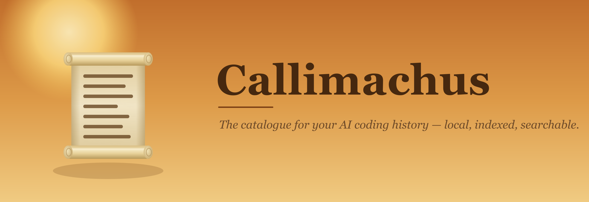

<p align="center">
  
</p>

<p align="center">
  <a href="LICENSE"></a>
  
  
  
  
  
</p>

> **Local index & search for your AI coding-agent threads** across **12 tools** (Claude Code, Codex, Cursor, Gemini CLI, Qwen Code, Goose, OpenCode, Continue, Cline, Roo Code, Kilo Code, Copilot Chat), plus a provider-agnostic chat, an MCP server, a CLI, and a VS Code / Cursor extension. Your history stays on your machine.

Named for [Callimachus](https://en.wikipedia.org/wiki/Callimachus), who built the first catalogue of the Library of Alexandria.

## Download

Grab the latest signed build from **[Releases](../../releases/latest)**: macOS (`.dmg`, Apple Silicon), Windows (`.msi` or `-setup.exe`), or Linux (`.AppImage`, `.deb` or `.rpm`). The app auto-updates from there on. Prefer to build it yourself? See [Develop](#develop).

**macOS:** drag Callimachus into Applications and open it from there before enabling the agent integration. While it runs from the disk image or a quarantined download, Settings won't register it, because that path disappears when the app quits.

**Windows uninstall:** the `-setup.exe` uninstaller removes what the app added (the `/recall` skill, the Claude Code hooks, the MCP entries for Claude Code, Codex, Cursor and Gemini CLI, and `cal.exe`), but the `.msi` uninstaller doesn't. Before removing an MSI install, click **Remove** under **Settings → Claude Code** and **Settings → Other agents** (or run `callimachus.exe --uninstall-integration`), or the hooks keep pointing at the deleted app and Claude Code reports a hook error at every session start.

The same release also carries standalone `cal-<target>` and `callimachus-mcp-<target>` binaries for CLI/MCP-only use, with their SHA-256 sums in `SHA256SUMS`. **Linux** builds and binaries need **glibc 2.38 or newer** (Ubuntu 24.04+, Debian 13+, Fedora 39+); Ubuntu 22.04, Debian 12 and RHEL 9 are too old for the bundled ONNX Runtime.

**Updates:** the first launch after an update upgrades the index in the background; the splash keeps animating, and on a large index this can take tens of seconds. An older build can't open an upgraded index: an older app shows "This index is from a newer Callimachus", and an older `cal`, `callimachus-mcp` or pinned `npx callimachus-mcp@<version>` stops with an error. Whichever of them opens the index first does the upgrade, so keep the app, the npx launcher and any standalone binaries on the same release.

## What it does

- **Indexes** every conversation from 12 coding agents into one local SQLite store: Claude Code, Codex, Cursor, Gemini CLI, Qwen Code, Goose, OpenCode, Continue, Cline, Roo Code, Kilo Code, and Copilot Chat (the built-in chat panel of VS Code, Cursor, VSCodium and Windsurf). Adding another source is a [small, documented contract](apps/desktop/src-tauri/src/indexer/README.md).
- **Searches** them with hybrid ranking: keyword (SQLite FTS5 / BM25) fused with on-device semantic similarity (sqlite-vec KNN, no cloud) via Reciprocal Rank Fusion. Filter by source, project, subagents, starred, and tags.
- **Finds code-aware**: type `file:embed/mod.rs` in the search bar (or `cal files <path>`) to find every thread that touched a path; backed by a file-mention index built at index time.
- **Distills knowledge**: free heuristic TODO extraction, plus opt-in LLM distillation of decisions, gotchas, and summaries, with cross-thread semantic recall of past decisions/gotchas. Optional **auto-distillation** works through threads active in the last 30 days in the background, up to a daily limit you set next to its toggle (50 threads by default, 0 pauses it; Settings shows what's left today), so memory self-populates without an open-ended bill. Runs on local Ollama (keyless), your logged-in **Claude Code or Codex CLI** subscription (keyless, no API key), or a cloud API key.
- **Curates the facts**: pin, edit, or delete distilled facts so your edits survive re-distilling, record a decision or gotcha yourself with **Remember** in the Projects tab (saved pinned), plus an LLM **"Review conflicts"** pass that flags decisions that contradict each other.
- **Remembers per project**: a **Projects** tab aggregates each repo's decisions, gotchas, and open TODOs into durable memory (grouped by a canonical project key, so worktrees / symlinks / `~` don't split one repo), with an LLM brief and a managed `.callimachus/memory.md`. That memory is prepended when you "Open in CLI", and you can inject it into any agent automatically: **Update AGENTS.md** (or `cal agents`) writes a managed block into the repo's `AGENTS.md` / `CLAUDE.md`, and `cal hook` feeds a size-budgeted version to a Claude Code SessionStart hook, labeled as notes from past sessions rather than instructions. The hook runs on startup, `/clear` and compaction (a shorter refresher), stays quiet on a resumed session, and skips a repo whose `CLAUDE.md` (or a file it `@`-imports) already holds the managed block, so the memory is injected once.
- **Asks your history (RAG)**: a synthesized, cited answer over your own threads, with `[thread N]` citations back to the sources it used. Needs an LLM engine (Knowledge/distillation enabled).
- **Organizes into collections**: star threads and attach free-form tags, then filter the list by starred or by tag.
- **Chats** with an in-app agent (Anthropic / OpenAI / Gemini / OpenRouter / Ollama, local or Cloud, or your logged-in **Claude Code / Codex CLI** with no key) that can **search your own history** and **run shell commands with your approval**; streaming, cancellable, with live model lists. Chats are saved and become searchable too.
- **Carries context across tools**: open any thread in any agent CLI ("Open in Claude / Codex / Gemini …", seeded with the packed transcript), resume a Claude Code / Codex thread in its native CLI, copy context, or export a thread to Obsidian (optionally AI-summarized with decisions / gotchas / TODOs).
- **Links threads to commits**: infers **on-device** which git commits a thread produced, by overlapping the files a thread discussed with `git log`'s changed files inside the thread's time window (shared-file count = confidence). See it as a thread→commit timeline (`cal commits`), per-thread in the desktop UI ("Produced commits"), or via the `linked_commits` MCP tool.
- **Snapshots agent sessions**: durable, resumable checkpoints of a thread (packed transcript + carry-forward project memory) for handoff across a context-window compaction or across tools; auto-captured by a Claude Code PreCompact hook right before a context compaction. Take, list, and resume them (`cal snapshot` / `cal snapshots` / `cal resume`, or the `snapshot_session` / `list_snapshots` / `load_snapshot` MCP tools).
- **Guards decisions**: decisions can carry a **rationale** ("why"), and an active guard surfaces settled decisions on a topic before an agent re-litigates one (`cal check "<proposal>"` / the `check_decision` MCP tool).
- **Recalls before you redo**: an opt-in Claude Code hook quietly injects "you may have solved this before" into the agent's context on each prompt when it strongly matches prior work (Settings → Claude Code → **Proactive recall**, off by default, signal-floored and per-session deduped).
- **Mines recurring issues**: surfaces the errors you keep hitting across all your tools (normalized signatures, last 180 days) so you fix the pattern, not the instance (a Coach card, or `cal issues`).
- **Shows what it cost**: captures per-message token usage and model at index time, then estimates dollar spend by model and your priciest threads (a Stats card, or `cal cost`; reindex once to backfill).
- **Feeds PR audits**: `cal audit-pr <repo> --changed-files … --shas …` returns one JSON bundle (per-commit provenance back to the session that produced it, per-file prior threads + reasoning, repo recurring errors, project memory) so an external local PR-review tool can show the history behind a diff.
- **Surfaces to your agents**: a bundled MCP server (`callimachus-mcp`) exposes the index as tools any agent can call mid-session, and it's two-way: agents can write back into Callimachus's own memory (close TODOs, record decisions/gotchas, snapshot a session) without ever touching your files. The `/recall` skill teaches them when to use it.
- **Stays current** via a background file watcher, plus a catch-up pass at launch for the sessions your agents wrote while the app was closed; **stays private**: the index never leaves your machine, API keys live in the OS keychain, conversation content goes only to an AI provider you pick, and usage analytics are opt-in and content-free (see [Security & privacy](#security--privacy)).

## Stack

- **Shell:** Tauri 2 (Rust) + React 19 + TypeScript + **Vite 8**
- **Store/search:** bundled SQLite + FTS5 (`rusqlite`); on-device embeddings via `fastembed` (bge-small-en-v1.5, 384-dim); KNN in SQL via `sqlite-vec` (vec0)
- **Watcher:** `notify` + debouncer
- **Chat:** multi-provider via the `genai` crate (Anthropic / OpenAI / Gemini / OpenRouter / Ollama local + Ollama Cloud), each with a configurable base URL, streaming tokens over a Tauri Channel, cancellable, with agent tool-calls (history search + approved shell)
- **Secrets:** OS credential store via the cross-platform `keyring` crate: macOS Keychain, Windows Credential Manager, Linux Secret Service
- **Entry points:** the app binary also runs as `cal` (through the `~/.local/bin/cal` link or `cal.exe`) and as the MCP server (`--mcp`); the standalone `cal` and `callimachus-mcp` release binaries are the same code built on their own. All of them reuse the desktop core lib against the same `index.db`
- **Editor:** a VS Code / Cursor extension (`apps/vscode`, published to the Marketplace + Open VSX) that shells out to `cal`

## Monorepo

This is a [Turborepo](https://turborepo.com) + pnpm workspace.

```
apps/
  desktop/            # the Tauri 2 desktop app + the cal CLI and MCP server (src-tauri)
  vscode/             # VS Code / Cursor extension (search history from the editor)
  web/                # callimachus.app, the marketing + download site (TanStack Start)
packages/
  callimachus-mcp/    # the npm launcher behind `npx -y callimachus-mcp`
.changeset/           # version + changelog management
scripts/              # version-sync, release tagging
```

Releases, versioning, and the auto-updater are documented in [RELEASING.md](RELEASING.md).

## Develop

```bash
pnpm install
pnpm desktop:dev      # launches the desktop window (tauri dev) against a separate dev index

# from the repo root, across all apps:
pnpm build            # turbo: build every app's frontend
pnpm typecheck        # turbo: typecheck every app
```

First launch: the index is empty, so the Search screen offers **Index my history** (or use **Reindex** in **Settings → Sources**); then **Build semantic index** enables semantic search. Later launches also index whatever your agents wrote while the app was closed. **Reindex** runs as a background job with a per-source progress bar, separate from **Build semantic index**. The two are mutually exclusive (one pauses while the other holds the write lock).

### Tests

```bash
cd apps/desktop/src-tauri
cargo test                                   # fast unit tests
cargo test -- --ignored --nocapture          # real-data + model + keychain smoke tests
```

The `--ignored` tests touch live data on this machine: each source has a `real_<source>_index` smoke test that indexes your real history read-only (`~/.claude`, `~/.codex`, Cursor, `~/.gemini`, `~/.qwen`, Goose, OpenCode, Continue, Cline/Roo/Kilo), plus the embedding-model download (first run, needs network) and a Keychain round-trip.

## Use your history anywhere

Beyond the desktop window, the same local index is reachable from your agents, terminal, and editor, all reading one `index.db`.

**MCP server**: let any agent search its own past work mid-session. It reads the index the desktop app builds and does not index anything by itself, so install the app and let it index once first. The quickest way to register it is `npx` (it downloads the prebuilt binary on first run and verifies its SHA-256); it's also listed on the official [MCP registry](https://registry.modelcontextprotocol.io) as `io.github.BetaBots-LLC/callimachus`:

```bash
claude mcp add callimachus -- npx -y callimachus-mcp    # or any MCP client
```

Already running the desktop app? You don't need npm: **Settings → Claude Code → Enable for Claude Code** registers the app itself (launched with `--mcp`) as Claude Code's MCP server, and **Settings → Other agents** does the same for Codex, Cursor and Gemini CLI. The app keeps those entries pointed at itself after an update or a move. You can also download the standalone `callimachus-mcp-<target>` binary from [Releases](../../releases/latest), or build from a checkout with `cargo install --locked --path apps/desktop/src-tauri --bin callimachus-mcp`.

Tools (22), read **and** write. Reads (18): `search_threads`, `search_current_project` (auto-scoped to the repo it runs in), `recent_threads`, `get_thread`, `list_tags`, `list_open_todos`, `get_thread_knowledge`, `recall_decisions`, `recall_gotchas`, `find_prior_work` (the "have I done this before?" guard: prior sessions similar to a task), `project_memory` (a project's aggregated decisions / gotchas / open TODOs), `ask_history` (a cited RAG answer over your history), `threads_for_file` (which sessions touched a path), `check_decision` (surface settled decisions before re-litigating a proposal), `linked_commits` (the commits a thread likely produced), `recurring_issues` (errors you keep hitting across sessions), `list_snapshots` (a project's session snapshots), and `load_snapshot` (restore a saved checkpoint). Writes (4, into Callimachus's own memory, never your code): `complete_todo` (close an open TODO), `record_decision` (optionally with a `rationale`), `record_gotcha` (persist a fact into a project's memory), and `snapshot_session` (checkpoint a thread for handoff). The bundled `/recall` skill ([resources/recall/SKILL.md](apps/desktop/src-tauri/resources/recall/SKILL.md)) tells agents when to reach for them.

Results are compact JSON sized for an agent's context. The search tools return one entry per thread with its matching `snippets`, `get_thread` and `load_snapshot` take an optional `budget` (default 24,000 chars, max 96,000), and `project_memory` returns size-budgeted markdown by default (`format: "json"` for data, plus `limit` and `kinds`). Until the app has indexed something, every read tool answers with setup instructions instead of an empty list.

**CLI**: `cal`, pipe-friendly. The desktop app installs it with **Settings → Claude Code → Enable for Claude Code**: on macOS and Linux it is linked at `~/.local/bin/cal` (if `~/.local/bin` isn't on your shell's `PATH`, as on stock macOS, Settings shows the `export PATH=...` line to add), and on Windows it is placed as `cal.exe` next to the app. If another program already owns `~/.local/bin/cal`, or a per-machine Windows install can't write `cal.exe`, Callimachus leaves `cal` out and says so in Settings; the hooks, MCP server and `/recall` skill work without it. You can also download the standalone `cal-<target>` binary from [Releases](../../releases/latest), or build from a checkout with `cargo install --locked --path apps/desktop/src-tauri --bin cal`.

```bash
cal search "vector index migration" -y    # -y = hybrid (semantic + keyword)
cal recent -n 10
cal cat 42 | pbcopy                        # packed transcript → clipboard
cal stats                                  # index totals + per-source breakdown
cal export 42 --vault ~/Obsidian           # write a thread as an Obsidian note
cal ask "how did we set up releases?"      # cited RAG answer over your history
cal files embed/mod.rs                     # threads that touched a file path
cal memory                                 # this repo's distilled memory (decisions/gotchas/TODOs)
cal done 17                                # mark an open TODO done (id from `cal todos`)
cal remember decision "use sqlite-vec for KNN" --because "no cloud, KNN in SQL"  # record a fact (+ rationale) into the repo's memory
cal check "switch to pgvector"             # surface settled decisions before re-litigating one
cal commits                                # infer the thread→commit timeline for this repo (--json; or pass a path)
cal issues                                 # recurring errors you keep hitting across sessions (last 180 days)
cal cost                                   # estimated $ spend by model + your priciest threads
cal audit-pr . --changed-files a,b --shas s1,s2  # one JSON bundle for an external PR auditor
cal snapshot 42 -l "pre-refactor"          # checkpoint a thread for handoff (transcript + project memory)
cal snapshots                              # list saved session snapshots (optionally for a project)
cal resume 7 -a claude                     # resume a snapshot in an agent CLI
cal agents                                 # write the repo's memory into AGENTS.md (any agent reads it)
cal hook                                   # print the repo's memory (use as a Claude Code SessionStart hook)
```

`star`, `tag`, `tags`, `todos`, `knowledge`, `distill`, `decisions`, `gotchas`, `related`, and `similar` (the "have I done this before?" check) also exist. Run `cal help` for the full list.

**VS Code / Cursor**: the extension adds a "Callimachus History" sidebar, a status-bar search button, and commands to search / insert / copy threads (it shells out to `cal`). Install from the **[VS Code Marketplace](https://marketplace.visualstudio.com/items?itemName=BetaBotsLLC.callimachus-vscode)** or **[Open VSX](https://open-vsx.org/extension/BetaBotsLLC/callimachus-vscode)** (the registry **Cursor** and VSCodium use), or grab the `.vsix` from [Releases](../../releases). See [apps/vscode/README.md](apps/vscode/README.md).

## Notes / limitations

- Cross-platform (macOS / Windows / Linux), including the "Open in CLI" / "Resume" launchers. They open Terminal on macOS, a new console window on Windows, and on Linux the first terminal they find (`$TERMINAL`, then `x-terminal-emulator`, GNOME Terminal, Konsole, xfce4-terminal, kitty, Alacritty, WezTerm, xterm). On a Linux machine with none of these, the buttons are hidden.
- Cline / Roo Code / Kilo Code are editor extensions with no CLI, so they are index-only (searchable, but not relaunchable via "Resume").
- Cursor doesn't store a per-thread workspace, so Cursor threads currently have no project path.
- Claude Code subagent transcripts are indexed but hidden behind a "subagents" toggle by default.
- Moved your Claude Code or Codex data (`CLAUDE_CONFIG_DIR` / `CODEX_HOME`)? An app opened from the Dock, Finder or Start menu doesn't see shell variables, so set those folders under **Settings → Sources** (changing one reindexes that source).
- Large first index is a one-time cost (the Claude corpus here was ~90k messages in ~25s); subsequent passes skip unchanged files.
- The index (`index.db`), the embedding model (`models/`) and the app's diagnostics log (`callimachus.log`) live together in the per-user app data folder `dev.shaller.callimachus` (`~/Library/Application Support` on macOS, `%LOCALAPPDATA%` on Windows, `~/.local/share` on Linux). Attach `callimachus.log` to a bug report.
- More sources (Charm Crush, Factory Droid, and the standalone Copilot CLI) are scoped but not yet integrated; Copilot Chat in VS Code-family editors is already indexed. See [the indexer guide](apps/desktop/src-tauri/src/indexer/README.md).

## Contributing

Issues and PRs welcome. [CONTRIBUTING.md](CONTRIBUTING.md) covers local setup, conventions, and the release flow. Adding support for another agent is a [small, documented contract](apps/desktop/src-tauri/src/indexer/README.md), usually one indexer module + a migration + a few wiring points.

## Security & privacy

Callimachus is local-first. Your index, transcripts and memory never leave your machine, except conversation content you explicitly send to an LLM provider you choose (the in-app chat, Knowledge distillation, Ask your history, project briefs and conflict review, and AI-summarized Obsidian exports; local Ollama keeps even that on-device) and the excerpts that agents you connect over MCP or hooks pull into their own sessions. API keys live in the OS keychain, never on disk.

The desktop app can send anonymous, **opt-in** usage analytics to PostHog (US): event names, app version, OS, CPU architecture and language, and a few properties picked from fixed lists (such as which agent source, AI provider or setting an event concerns, an error category, or a count rounded into a range), tied to a random install ID. It never sends file paths, thread titles, prompts, transcripts, project names or API keys. It is off until you choose **Allow**, and you can turn it off any time in **Settings → General** or with `CALLIMACHUS_TELEMETRY=0` / `DO_NOT_TRACK=1`. The CLI and MCP server never send analytics. The only other network traffic is the update check against GitHub Releases and the embedding-model download from Hugging Face (desktop app only, the first time you build the semantic index). The website uses PostHog in cookieless mode (no cookies, no cross-site tracking).

The full breakdown is in [SECURITY.md](SECURITY.md) and the [privacy policy](https://callimachus.app/privacy). To report a vulnerability, see [SECURITY.md](SECURITY.md).

## License

**Dual-licensed.** Free and open source under **[AGPL-3.0-or-later](LICENSE)**: use,
modify, and share it; if you distribute it or run a modified version as a network
service, you must release your source under the AGPL.

For **closed-source, proprietary, or for-profit/SaaS use** that the AGPL doesn't
permit, a **commercial license** is required. See **[COMMERCIAL.md](COMMERCIAL.md)**
(contact ari@shaller.dev).

© 2026 Ari Shaller. See [NOTICE](NOTICE) for attributions. Contributions are accepted
under the terms in [CONTRIBUTING.md](CONTRIBUTING.md).

## Acknowledgements

Built on [Tauri](https://tauri.app), [fastembed-rs](https://github.com/Anush008/fastembed-rs), [sqlite-vec](https://github.com/asg017/sqlite-vec), and [genai](https://github.com/jeremychone/rust-genai). Named for [Callimachus of Cyrene](https://en.wikipedia.org/wiki/Callimachus), who catalogued the Library of Alexandria.

<p align="center"><sub>Social preview: <a href="assets/og.png"><code>assets/og.png</code></a> · brand sources in <a href="assets/brand"><code>assets/brand/</code></a></sub></p>
